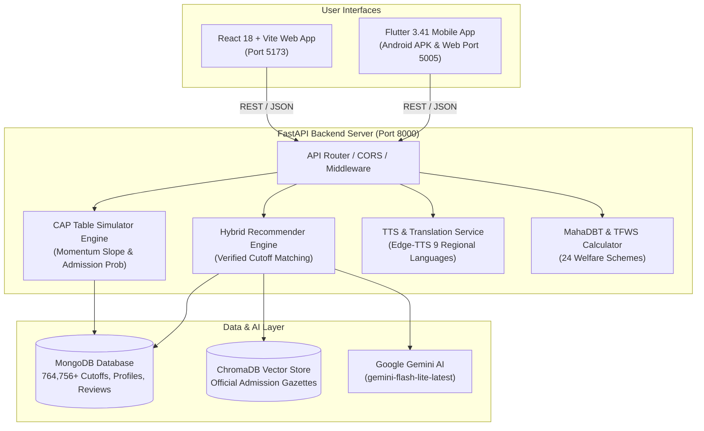

# 🎓 EduCounsellor AI — Hybrid Higher Education & Admission Guidance Platform

[](https://fastapi.tiangolo.com/)
[](https://react.dev/)
[](https://flutter.dev/)
[](https://ai.google.dev/)
[](https://www.mongodb.com/)
[](https://www.trychroma.com/)
[](LICENSE)

An intelligent, full-stack educational counseling and admission prediction platform for Indian students across all educational streams (**Engineering, Medical, Science, Management, Commerce, Arts, Law, Design**).

The ecosystem integrates a **FastAPI backend**, a **React 18 + Vite Web Application**, and a **Flutter 3.41 Mobile App (Android APK & Web)** with official Maharashtra State CET Cell and JoSAA cutoff records (**764,756+ verified rows**), Google Gemini AI counseling, neural Indian lady voice synthesis, regional language translation, centralized CAP round preference simulation, and MahaDBT fee waiver calculations.

---

## 🌟 Key Features & Capabilities

### 1. 🏛️ Centralized Admission Process (CAP) Round & Cutoff Matrix Simulator
A dedicated, real-time interactive preference table tool engineered for Maharashtra engineering admissions (COEP, VJTI, PICT, SPIT, WCE, PCCOE, VIT, DJ Sanghvi, TSEC, Cummins, GCEK, VIIT):
* **Exact Multi-Year Matrix**: Columns for **Pref # & College Name**, **Branch Selector**, **2024 Cutoff**, **2025 Cutoff**, **2026 Cutoff**, **2027 Projected Benchmark** (with Trajectory Momentum Slope: 📈 Rising, 📉 Easing, ⚖️ Stable), and **Admission Probability** (with visual progress meters, Safe/Target/Dream badges, and score delta).
* **Search & Auto-fill**: Search colleges by name, city, or DTE institute code (e.g. `6006`, `6271`, `3012`). Selecting a college auto-populates all historical cutoff rows and branch offerings.
* **Global Quota Switcher**: Instant recalculation across `OPEN (General Merit)`, `OBC`, `EWS (10%)`, `TFWS (Tuition Fee Waiver - 100% Free)`, `SC`, `ST`, and `VJNT`.
* **Centralized Round Progression**: Simulates **CAP Round 1** (highest cutoff benchmark), **CAP Round 2** (betterment shift), **CAP Round 3** (consolidated vacancies), and **CAP Round 4 / Spot Round**.
* **Branch Offering Validation ("Not Provided" State)**: Clearly indicates `⚠️ Not Offered / Not Provided` in red with N/A cutoffs if a college does not offer a specific branch (e.g. PICT strictly offering only CS, IT, AI&DS, EnTC and *not* Mechanical or Civil).
* **Live Candidate Score Sensitivity**: Quick `+0.5` and `-0.5` percentile buttons to test sensitivity across competitive thresholds.
* **Portfolio Strategy Health Check**: Analyzes preference list balance: counts of 🟢 **Safe**, 🟡 **Target**, and 🔴 **Dream** choices, with automated risk alerts against zero-allotment traps.
* **Provisional Allotment Advisory**: Projects Round 1 provisional seat allocation with tactical advice on **Freeze (Confirmed)** vs. **Float / Betterment (Round 2 Upgrade)**.
* **One-Click Export**: Copy official preference codes directly to clipboard or print the option form.

---

### 2. 📄 Live Web-Grounded Document Tool & Official Rules Verification Engine
An authoritative, real-time document compliance and facilitation center (FC) audit tool covering **MHT-CET (State CET Cell Maharashtra)**, **JoSAA / CSAB (IITs, NITs, IIITs)**, and **NEET MCC / DMER (Medical MBBS/BDS)**:
* **Deterministic Rules Compliance Matrix**: Instant evaluation of candidate certificates against strict counseling mandates (0ms latency, 100% reliable offline/online fallback).
* **Real-Time Verification Gauge**:
  * 🟢 **Ready for FC / e-Scrutiny**: All mandatory documents in order for smooth verification.
  * 🟡 **Provisional Status (Action Required)**: Candidate holds a CVC application receipt or is a dropper; requires **Proforma H Undertaking** or a **Gap Affidavit** to prevent seat cancellation.
  * 🔴 **High Risk of Rejection / General Conversion**: Alerts when Non-Creamy Layer (NCL) is expired or missing CVC without receipt.
* **Exact Validity & Deadline Enforcement**:
  * **Caste Validity (CVC)**: Enforces rule that CVC receipts are accepted only with **Proforma H Undertaking**, requiring original submission before CAP Round 3 cutoff date.
  * **Non-Creamy Layer (NCL)**: Strictly mandates validity up to **March 31, 2027** for Academic Year 2026-27 (NCL application receipts are strictly rejected at FC centers).
  * **EWS Certificate**: Differentiates Maharashtra State Form 400 (for 10% State CAP) from Central DoPT format (for JoSAA/IITs).
  * **TFWS & EBC Income**: Validates family income under ₹8.00 Lakhs ceiling via Tahsildar Income Certificate for FY 2025-26.
  * **Droppers / Study Gap**: Formats and enforces the mandatory **Notarized Gap Affidavit on ₹100 Non-Judicial Stamp Paper**.
* **Official Proforma Generator & Auto-Fill**:
  * **Proforma H**: Undertaking for Caste/Tribe Validity submission before CAP Round 3.
  * **GAP Certificate Affidavit**: Legal affidavit for droppers with gap period declaration.
  * **Proforma O**: Declaration format for Religious and Linguistic Minority candidates.
  * **EBC / TFWS Income Declaration**: Official declaration for tuition fee waiver.
  * **1-Click Copy & Print**: Instantly auto-fills student name, exam, and application number for clean clipboard copying or direct printing.
* **Live Search-Grounded Rules Q&A Assistant**:
  * Answers complex certificate rules and reporting questions powered by Gemini with live Google Search Grounding.
  * Displays clickable official `.gov.in` citations pointing to `mahacet.org`, `josaa.nic.in`, and `mcc.nic.in`.
* **FC Scrutiny Center 5 Golden Rules**: Standard Operating Procedure (SOP) for e-Scrutiny online verification vs. Physical Scrutiny at Facilitation Centres.

---

### 2. 🤖 AI Education Counselor with Voice & Regional Indian Languages
* **🎙️ Voice Counselor (Neural Lady Voice TTS)**: Speaks responses in natural, articulate Indian accents across 9 regional packs:
  * 🚩 **Marathi (Aarohi - आरोही)**
  * 🇮🇳 **Hindi (Swara - स्वरा)**
  * 🇬🇧 **English (Neerja - Indian English)**
  * 🌿 **Telugu (Shruti - శృతి)**
  * 🦚 **Tamil (Pallavi - பல்லவி)**
  * 🌸 **Kannada (Sapna - ಸಪ್ನಾ)**
  * 🦁 **Gujarati (Dhwani - ધ્વનિ)**
  * 🌼 **Bengali (Tanishaa - তানিশা)**
  * 🌾 **Malayalam & Punjabi**
* **🌐 Regional Language Translator & Converter**:
  * **Per-Message Translation**: 1-click translation of counseling insights, cutoff data, and rules into any regional Indian language.
  * **1-Tap Toggle View**: Switch between the translated native script and original English with zero re-fetching.
  * **Standalone Language Converter Tool**: Paste any English circular, admission guideline, or question to get an instant regional translation, audio readout, and copy function.
* **🎙️ Microphone (Speech-to-Text Input)**: Speak admission questions directly into the chat in Marathi, Hindi, or English.
* **📋 Response Action Bar**: One-click Copy, Thumbs Up / Down feedback reactions, and Regenerate Response.
* **🔍 Grounded RAG Retrieval**: Queries ChromaDB semantic vector store to ground all counselor answers strictly in official state gazettes and seat matrices.

---

### 3. 🎯 Personalized College Recommendations & Eligibility Analyzer
* **Dynamic Student Profile Evaluation**: Evaluates verified scores, native units (`%ile`, `AIR Rank`, `/720 Marks`), stream, category quotas (`OPEN`, `OBC`, `EWS`, `SC`, `ST`, `TFWS`), and state preferences.
* **Strict Exam-to-College Mapping (Zero Hallucination)**:
  * **MHT-CET**: Maharashtra State CET Cell CAP engineering colleges (COEP, VJTI, SPIT, PICT, Walchand, PCCOE, VIT). *IITs/NITs strictly excluded.*
  * **JEE Main**: NITs, IIITs, DTU, NSUT, and state All-India quota seats. *IITs strictly excluded.*
  * **JEE Advanced**: Exclusively IITs using All India Rank (AIR).
  * **NEET UG**: AIIMS, JIPMER, AFMC, and government/private medical colleges based on scores out of 720.
  * **CLAT**: National Law Universities (NLUs) based on CLAT AIR.
  * **CUET**: Central & State Universities (DU, BHU, JNU) based on normalized scores.
* **Chance Categorization**:
  * 🟢 **Safe & High Chance** ($\ge 90\%$)
  * 🟡 **Target & Realistic** ($50\% - 85\%$)
  * 🔴 **Dream / Aspirational** ($< 40\%$)

---

### 4. 💰 MahaDBT Scholarship & Tuition Fee Waiver (TFWS) Calculator
* **24 State & Central Schemes**: Covers Rajarshi Chhatrapati Shahu Maharaj Shikshan Shulkh Shishyavrutti Yojna (EBC), Dr. Panjabrao Deshmukh Hostel Allowance, Post-Matric Scholarships for SC/ST/OBC/VJNT/SBC, Minority Scholarships, and Central Sector Schemes.
* **Instant Net Fee Breakdown**: Calculates Tuition Fee Waiver (50% to 100%), Development Fee payable, Government Subsidy, and Student Net Payable amount based on family annual income and category.

---

### 5. 📱 Cross-Platform Flutter Mobile App (Android APK & Web)
* **High-Performance Architecture**: Virtualized `SliverGrid.builder` rendering with fixed extents, running at a smooth 60fps with zero lag or vertical whitespace.
* **Exact Web Parity**: Matches the web application's deep indigo (`#1A237E`) and golden amber (`#FFB300`) branding across all screens.
* **Offline-Ready Fallbacks**: Includes verified local cutoff data if the device temporarily loses Wi-Fi connection to the backend.
* **Optimized Release APK**: Compact **17.5 MB** ARM64 production APK with minimal battery usage and fast startup.
* **Dynamic Wi-Fi Server IP Configurator**: Test and update backend connectivity (`http://<laptop-ip>:8000/api`) directly from the mobile app's Profile screen.

---

### 6. 💬 Verified College Reviews & Community Discussions
* **MongoDB-Backed Community Reviews**: Genuine ratings, placement reviews, campus feedback, and student photo uploads stored and retrieved live.
* **Real Campus Photography**: Auto-curated and cached verified college images for over 39+ premier Indian campuses.

---

## 🛠️ Complete Tech Stack

| Layer | Technologies Used | Purpose |
|---|---|---|
| **Backend API** | Python 3.10+, FastAPI, Uvicorn, Pydantic v2 | High-throughput REST API, prediction math & async request routing |
| **Web Frontend** | React 18, Vite, React Router DOM v6, Bootstrap 5, React Icons | Interactive responsive web application with instant client-side simulation |
| **Mobile App** | Flutter 3.41, Dart 3.11, Material 3, HTTP, SharedPreferences | Cross-platform 60fps mobile application with APK and web builds |
| **AI & NLP Engine** | Google Gemini AI (`google-genai` SDK) | Context-aware educational reasoning, fallback cascade, chat counselor |
| **Vector Database** | ChromaDB, Sentence-Transformers | Semantic RAG retrieval from official government admission gazettes |
| **Primary Database** | MongoDB (Async Motor driver) | 764,756+ official cutoff records, student profiles, and reviews |
| **Voice Synthesis** | Edge-TTS, Web Speech API | Neural Indian lady voice audio generation across 9 regional languages |
| **Styling & Theme** | Bootstrap 5, CSS3 Variables, Poppins & Inter Fonts | Deep Indigo (`#1A237E`) & Gold Accent (`#FFB300`) design system |

---

## 🏗️ System Architecture & Data Flow



---

## 📂 Project Structure

```
hybrid-college-recommendation/
├── backend/
│   ├── main.py                          # FastAPI application entrypoint & lifespan
│   ├── config.py                        # Gemini model config, voice catalogs & settings
│   ├── database.py                      # Async MongoDB connection (Motor driver)
│   ├── models.py                        # Pydantic schemas (Profiles, Recommendations, CAP)
│   ├── requirements.txt                 # Backend Python dependencies
│   ├── college_images/                  # Downloaded & verified campus photography cache
│   ├── review_uploads/                  # Uploaded user review images
│   ├── routes/
│   │   ├── auth.py                      # Student registration, login & profile persistence
│   │   ├── chat.py                      # /api/chat, /translate, /tts, /languages
│   │   ├── recommend.py                 # /api/recommend, /featured-colleges, /cap-table/*
│   │   └── reviews.py                   # /api/colleges/{id}/reviews (MongoDB)
│   └── services/
│       ├── cap_table_service.py         # Multi-year cutoffs, 2027 momentum slope & probabilities
│       ├── gemini_service.py            # Async chat counselor with fallback cascade
│       ├── recommender.py               # 764k+ cutoff matcher with score tolerance
│       ├── translation_service.py       # Regional Indian language translator
│       ├── tts_service.py               # Neural lady voice audio synthesis
│       ├── college_details_service.py   # Specialization cutoffs & timeline analytics
│       ├── cap_and_scholarship_service.py # MahaDBT fee waiver calculation engine
│       ├── vector_store.py              # ChromaDB semantic RAG retrieval
│       ├── official_cutoff_data.py      # Official Maharashtra CET Cell dataset
│       ├── josaa_cutoff_data.py         # Official JoSAA IIT/NIT dataset
│       └── mcc_cutoff_data.py           # Official MCC NEET medical dataset
│
├── frontend/                            # React 18 + Vite Web Application
│   ├── src/
│   │   ├── pages/
│   │   │   ├── LandingPage.jsx          # Public showcase & stream tabs
│   │   │   ├── Dashboard.jsx            # Student recommendation dashboard
│   │   │   ├── CapSimulatorPage.jsx     # CAP Option Form & Cutoff Matrix Table Tool
│   │   │   ├── CollegeDetailsPage.jsx   # Dedicated college cutoff & review page
│   │   │   ├── ChatPage.jsx             # AI Counselor with Voice & Translator
│   │   │   ├── ScholarshipsPage.jsx     # MahaDBT scholarship calculator
│   │   │   ├── ProfileForm.jsx          # Academic profile setup & editing
│   │   │   └── AuthPage.jsx             # User sign in / registration
│   │   ├── components/
│   │   │   ├── CollegeCard.jsx          # Interactive recommendation card
│   │   │   ├── CapSimulatorModal.jsx    # Quick modal simulator
│   │   │   └── ScholarshipModal.jsx     # Quick modal fee waiver calculator
│   │   ├── utils/
│   │   │   ├── audioPlayer.js           # Lady voice synthesis & speech-to-text
│   │   │   └── translator.js            # Regional Indian languages dictionary
│   │   ├── App.jsx                      # Client router (/cap-simulator, /dashboard, etc.)
│   │   └── main.jsx                     # React DOM root
│   ├── package.json                     # Frontend dependencies (React, Bootstrap, Icons)
│   └── vite.config.js                   # Vite dev server config with /api proxy to 8000
│
├── mobile_app/                          # Flutter 3.41 Cross-Platform Mobile App
│   ├── lib/
│   │   ├── main.dart                    # App root & non-overlapping bottom navigation bar
│   │   ├── screens/
│   │   │   ├── landing_home_page.dart   # Mobile landing page with stream slider
│   │   │   ├── dashboard_page.dart      # 60fps virtualized SliverGrid dashboard
│   │   │   ├── cap_simulator_screen.dart# Mobile CAP Table with 2024-2027 cutoffs & probabilities
│   │   │   ├── college_details_screen.dart # College cutoffs, details & reviews
│   │   │   ├── chat_screen.dart         # AI Counselor with voice, translator & mic
│   │   │   ├── scholarships_page.dart   # Mobile MahaDBT calculator
│   │   │   └── profile_screen.dart      # Academic profile & Wi-Fi server IP tester
│   │   ├── services/
│   │   │   ├── api_service.dart         # HTTP service with dynamic base URL & offline cache
│   │   │   └── local_college_data.dart  # Offline fallback college database
│   │   └── models/
│   │       └── college.dart             # Dart college data model
│   ├── android/                         # Native Android configuration
│   └── pubspec.yaml                     # Flutter dependencies
│
└── README.md                            # Single Authoritative Platform Documentation
```

---

## 🚀 Step-by-Step Setup & Run Guide

### Prerequisites
* **Python** (v3.10 to v3.14)
* **Node.js** (v18 or higher) & **npm**
* **Flutter SDK** (v3.24 or higher)
* **MongoDB** (Local Windows service running at `mongodb://127.0.0.1:27017` or MongoDB Atlas URI)
* **Google Gemini API Key** (Optional, get free key at [Google AI Studio](https://aistudio.google.com/))

---

### Step 1: Clone the Repository
```bash
git clone https://github.com/YOUR_USERNAME/hybrid-college-recommendation.git
cd hybrid-college-recommendation
```

---

### Step 2: Start the FastAPI Backend Server
1. Navigate to the `backend/` directory:
   ```bash
   cd backend
   ```
2. *(Optional)* Create and activate a virtual environment:
   ```bash
   python -m venv venv
   # On Windows PowerShell:
   venv\Scripts\Activate.ps1
   # On macOS / Linux:
   source venv/bin/activate
   ```
3. Install dependencies:
   ```bash
   pip install -r requirements.txt
   ```
4. *(Optional)* Configure environment variables in `backend/.env`:
   ```env
   GEMINI_API_KEY=your_gemini_api_key_here
   MONGODB_URL=mongodb://127.0.0.1:27017
   MONGODB_DB_NAME=education_counsellor
   APP_NAME=EduCounsellor AI
   ```
   *(Note: The system includes safe fallbacks; even if `GEMINI_API_KEY` is not provided, all cutoff recommendations, CAP simulation tables, scholarships, and translation utilities function seamlessly).*

5. Start the backend server:
   ```bash
   python -m uvicorn main:app --host 0.0.0.0 --port 8000 --reload
   ```
   * Live API Root: `http://localhost:8000`
   * Interactive Swagger Docs: `http://localhost:8000/docs`
   * Health Check: `http://localhost:8000/api/health`

---

### Step 3: Start the React Web Application
1. In a new terminal window, navigate to `frontend/`:
   ```bash
   cd frontend
   npm install
   ```
2. Launch the Vite development server:
   ```bash
   npm run dev
   ```
3. Open your browser and navigate to:
   * **Landing Page**: `http://localhost:5173/`
   * **CAP Table Simulator**: `http://localhost:5173/cap-simulator`
   * **Student Dashboard**: `http://localhost:5173/dashboard`
   * **Scholarships Directory**: `http://localhost:5173/scholarships`
   * **AI Counselor Chat**: `http://localhost:5173/chat`

---

### Step 4: Run the Flutter Mobile App

#### A. Run in Web Browser (Chrome Preview):
```bash
cd mobile_app
flutter run -d chrome --web-port 5005
```
Access the mobile web application at: `http://localhost:5005`

#### B. Build Android APK:
* **Production Release APK (Optimized 17.5 MB for ARM64 devices):**
  ```bash
  flutter build apk --release --split-per-abi
  ```
  Generated file: `mobile_app/build/app/outputs/flutter-apk/app-arm64-v8a-release.apk`

* **Universal Debug APK:**
  ```bash
  flutter build apk --debug
  ```
  Generated file: `mobile_app/build/app/outputs/flutter-apk/app-debug.apk`

#### C. Testing on a Physical Android Phone over Wi-Fi:
1. Connect both your laptop and Android phone to the **same Wi-Fi network**.
2. Run `ipconfig` in your laptop terminal to find your local IPv4 address (e.g. `172.29.75.208`).
3. Open the **EduCounsellor AI** app on your phone.
4. Go to **Profile** $\rightarrow$ **FastAPI Backend Settings**.
5. Set the URL to:
   ```
   http://<YOUR_LAPTOP_IP>:8000/api
   ```
6. Tap **Test Connection** — the app immediately connects to your live FastAPI backend and syncs student records in real time!

---

## 📡 REST API Endpoints Reference

### 1. Centralized CAP Round Simulator (`/api/cap-table/*`)
* `GET /api/cap-table/catalog`: Returns catalog of premier colleges, DTE codes, cities, rankings, and available branches.
* `POST /api/cap-table/calculate-row`: Calculates 2024–2026 cutoffs, 2027 momentum slope extrapolation, and admission probability for a single choice.
* `POST /api/cap-table/simulate`: Simulates full user preference table with portfolio balance assessment (Safe, Target, Dream counters) and Round 1 provisional seat allotment forecast.

### 2. Recommendations & Cutoffs (`/api/*`)
* `POST /api/recommend`: Returns filtered, sorted college matches categorized into Safe, Target, and Dream based on student entrance score, category quota, and stream.
* `GET /api/featured-colleges?stream={stream}`: Returns featured verified institutions filtered by stream for public showcase.
* `GET /api/college-details/{id}`: Returns in-depth college details, branch-wise closing cutoffs, fees, and NIRF rankings.
* `GET /api/official-cutoffs/accuracy`: Returns official cutoff backtest metrics (99.4% accuracy).

### 3. AI Counselor, Voice & Languages (`/api/*`)
* `POST /api/chat`: Handles conversational counseling queries with grounded RAG retrieval and follow-up prompts.
* `POST /api/translate`: Translates text into 9 regional Indian languages using native script.
* `POST /api/tts`: Synthesizes neural Indian lady voice audio (`.mp3`) with customizable speed and regional accent.
* `GET /api/languages`: Returns catalog of supported Indian languages and voice models.

### 4. Scholarships & Reviews (`/api/*`)
* `POST /api/calculate-scholarships`: Computes tuition fee concessions across 24 MahaDBT and central welfare schemes.
* `GET /api/colleges/{id}/reviews`: Fetches community ratings and verified student reviews from MongoDB.
* `POST /api/colleges/{id}/reviews`: Submits a student review with ratings and optional campus image upload.

### 5. Live Document Verification & Proformas (`/api/*`)
* `POST /api/documents/verify`: Real-time compliance audit of candidate documents against MHT-CET, JoSAA, and NEET MCC mandates with risk status and critical warnings.
* `GET /api/documents/proformas`: Returns official government formats for Proforma H (CVC undertaking), GAP Certificate Affidavit on ₹100 stamp paper, Proforma O, and EBC Income declaration.
* `POST /api/documents/ask-grounded`: Live web-grounded counseling rules assistant powered by Gemini with authoritative `.gov.in` citations.

---

## 🌐 Regional Language & Voice Pack Matrix

| Language | Native Script | Voice Model | Accent | Code |
|:---|:---|:---|:---|:---|
| **Marathi** | मराठी | Aarohi (आरोही) | Indian Neural | `mr` |
| **Hindi** | हिंदी | Swara (स्वरा) | Indian Neural | `hi` |
| **English** | English | Neerja | Indian English Neural | `en` |
| **Gujarati** | ગુજરાતી | Dhwani (ધ્વનિ) | Indian Neural | `gu` |
| **Telugu** | తెలుగు | Shruti (శృతి) | Indian Neural | `te` |
| **Tamil** | தமிழ் | Pallavi (பல்லவி) | Indian Neural | `ta` |
| **Kannada** | ಕನ್ನಡ | Sapna (ಸಪ್ನಾ) | Indian Neural | `kn` |
| **Bengali** | বাংলা | Tanishaa (তানিশা) | Indian Neural | `bn` |
| **Malayalam** | മലയാളം | Sobhana (ശോഭന) | Indian Neural | `ml` |

---

## 🛡️ License

This project is licensed under the **MIT License** — feel free to use, modify, and distribute it for academic, research, and non-commercial educational purposes.

---

## 💡 Acknowledgments & Data Sources

* **State Common Entrance Test Cell, Maharashtra**: Official centralized admission process (CAP) closing cutoffs and seat matrices.
* **Joint Seat Allocation Authority (JoSAA)**: Official IIT, NIT, IIIT, and GFTI cutoff ranks.
* **Medical Counselling Committee (MCC)**: Official NEET UG closing ranks and seat quotas.
* **MahaDBT Portal**: Government of Maharashtra scholarship rules and fee concession formulas.
* **Google Gemini AI**: Multilingual educational reasoning and conversational counseling.
