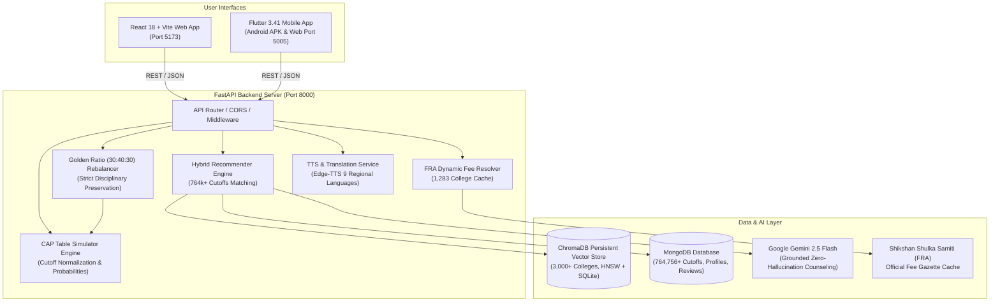

# 🎓 EduCounsellor AI — Hybrid Higher Education & Admission Guidance Platform

[](https://fastapi.tiangolo.com/)
[](https://react.dev/)
[](https://flutter.dev/)
[](https://ai.google.dev/)
[](https://www.trychroma.com/)
[](https://www.mongodb.com/)
[](https://excalidraw.com/)
[](LICENSE)

An intelligent, full-stack educational counseling, admission prediction, and Centralized Admission Process (CAP) simulation platform for Indian students across all educational streams (**Engineering, Medical, Science, Management, Commerce, Arts, Law, Design**).

The ecosystem integrates a **FastAPI backend**, a **React 18 + Vite Web Application**, and a **Flutter 3.41 Mobile App (Android APK & Web)** with official Maharashtra State CET Cell and JoSAA cutoff records (**764,756+ verified rows**), authentic **Shikshan Shulka Samiti (FRA)** tuition fee slabs, Google Gemini AI counseling, neural Indian lady voice synthesis, regional language translation, the **Golden Ratio (30:40:30) Option Form Rebalancer**, and MahaDBT fee waiver calculations.

---

## 🌟 Key Features & Capabilities

### 1. 🏛️ Centralized Admission Process (CAP) Simulator & Golden Ratio (30:40:30) Rebalancer
A dedicated, real-time interactive preference table tool engineered for Maharashtra engineering admissions (COEP, VJTI, PICT, SPIT, WCE, PCCOE, VIT, DJ Sanghvi, TSEC, Cummins, GCEK, VIIT) and Central entrance exams (JEE Main/Adv, NEET UG):
* **20-Preference Option Form UI**: Up to 300 preferences with drag-and-drop priority reordering and live generation of official 9-digit DTE Choice Codes (e.g., `600624510` for COEP Computer Engineering).
* **The Golden Ratio AI Auto-Rebalancer (30:40:30)**:
  * Solves the critical flaw where **80% of candidates submit high-risk option forms** (all unreachable Dream colleges leading to zero seat allotments, or overly conservative safe colleges wasting high percentiles).
  * Auto-calibrates candidate lists into:
    * 🔴 **30% Dream (Preferences 1–3)**: High-reach aspirational choices (COEP, VJTI, SPIT).
    * 🟡 **40% Target (Preferences 4–7)**: Realistic high-probability matches (PICT, Cummins, PCCOE).
    * 🟢 **30% Safe (Preferences 8–10)**: Non-negotiable safety net guaranteeing seat allotment.
* **Strict Disciplinary Preservation Guardian**:
  * Core algorithmic rule (`find_matching_branch_for_college`): Rebalancing **never** sacrifices the candidate's chosen discipline.
  * If a candidate targets **Computer Engineering**, the rebalancer strictly substitutes Computer Science / IT / AI programs—**never** swapping in unrelated branches like Metallurgy, Dyestuff, or Civil just to match a college name.
* **Dynamic Cutoff Normalization Engine**:
  * Real-time formula: $\text{Cutoff}_{\text{adjusted}} = \text{Cutoff}_{\text{base}} + \Delta_{\text{Category}} + \Delta_{\text{Round}}$
  * **Category Offsets**: OBC ($-0.75\%$), EWS ($-0.40\%$), TFWS ($+0.35\%$), SC ($-4.20\%$), ST ($-8.50\%$).
  * **Round Relaxation Offsets**: CAP Round 1 ($0.00\%$), Round 2 ($-0.65\%$), Round 3 ($-1.40\%$), Spot Round ($-2.25\%$).
* **3-Tier Probability & Momentum Classification**:
  * Evaluates score margin ($\text{Margin} = \text{Score} - \text{Cutoff}_{\text{adj}}$) into **Safe** ($\ge 0\%$, $>80\%$ prob), **Target** ($-1.5\%$ to $0\%$, $45-75\%$), and **Dream** ($< -1.5\%$, $5-35\%$).
  * Calculates trajectory momentum slope: $\text{Slope} = \frac{(C_{2026} - C_{2025}) + (C_{2025} - C_{2024})}{2}$ (📈 Rising, 📉 Easing, ⚖️ Stable).
* **Multi-Round Provisional Allotment Simulator**:
  * Simulates official centralized seat allotment: scans Preferences $1 \to 20$ sequentially. First choice clearing the cutoff is provisionally allotted.
  * Enforces official seat rules: **Preference #1 Allotment $\rightarrow$ Auto-Freeze**; **Preferences #2–20 $\rightarrow$ Float / Betterment** (student retains seat while participating in Round 2 & 3 for higher-ranked preferences).

---

### 2. 💵 Authentic Shikshan Shulka Samiti (FRA) Dynamic Annual Fee Engine
* **Eliminated Generic Flat Fees**: Replaced flat fee approximations with authentic fee structures sourced directly from Fee Regulating Authority (FRA) orders, Maharashtra State CET Cell master data, and official college gazettes.
* **Database Cache Resolution (`_DB_FEE_CACHE`)**:
  * Dynamically loads authentic annual fee records from `cutoffs_master` (1,283 colleges) and `mahacet_colleges` (372 colleges).
  * Accurately distinguishes Autonomous, Government, Private-Unaided, and University Unitary fee slabs.
* **Verified Benchmark College Fees**:
  * **COEP Tech University**: ₹1,35,000/yr
  * **VJTI Mumbai**: ₹92,000/yr (Govt Autonomous)
  * **ICT Mumbai**: ₹94,000/yr
  * **PICT Pune**: ₹1,15,000/yr
  * **SPIT Mumbai**: ₹1,72,000/yr
  * **Walchand Sangli**: ₹88,000/yr (Govt Aided)
  * **MKSSS Cummins (Women)**: ₹1,68,000/yr
  * **PCCOE Pune**: ₹1,38,000/yr
  * **VIIT Kondhwa Pune**: ₹1,58,000/yr
  * **AFMC Pune**: ₹25,000/yr
  * **AIIMS New Delhi**: ₹1,628/yr
  * **IIT Bombay**: ₹2,24,000/yr
* **2-Decimal Precision Formatting**: Consistent `formatAnnualFees(annual_fees)` across all cards, modals, tables, and export sheets without rounding down.

---

### 3. 📄 Live Facilitation Center (FC) Document Audit & Proforma Tool
* **Modern Two-Step Scrutiny Workflow**:
  * **Step 1: Verification Profile Inputs**: Clean, responsive layout for Category, Study Gap, Caste Validity (CVC), and Family Income.
  * **Step 2: Instant Audit & Compliance Results**: Real-time status gauge with actionable alerts (🟢 Ready for FC, 🟡 Provisional / Undertaking Required, 🔴 High Risk of General Conversion).
* **Exact Government Validity Rules**:
  * **Non-Creamy Layer (NCL)**: Strictly mandates validity up to **March 31, 2027** for AY 2026-27 (NCL application receipts rejected at FC).
  * **Caste Validity (CVC)**: CVC receipts allowed only with mandatory **Proforma H Undertaking** before CAP Round 3 cutoff.
  * **Income / EBC / TFWS**: Tahsildar Income Certificate validated under ₹8.00 Lakhs ceiling.
* **Official Pre-Filled Proforma Generator**:
  * **Proforma H Undertaking**: Auto-filled undertaking for CVC submission before Round 3.
  * **GAP Certificate Affidavit**: Legal affidavit format on ₹100 Non-Judicial Stamp Paper.
  * **Proforma O**: Minority declaration format.
  * **1-Click Copy & Print**: Instant auto-fill with student name, application ID, and date.

---

### 4. 🤖 AI Education Counselor with ChromaDB RAG & Voice Synthesis
* **ChromaDB Semantic Vector Retrieval (RAG)**:
  * Persistent vector storage (`backend/vector_store/chroma.sqlite3`) indexing **3,000+ verified college documents**.
  * Cosine similarity search against synthesized college text (5-year cutoff trajectory, category cutoffs, fees, placement stats, and gazette citations).
  * Plain text documents and official source citations are injected into Gemini 2.5 Flash with a **mandatory zero-hallucination directive**.
* **🎙️ Neural Indian Lady Voice TTS**:
  * Natural, articulate regional voice output across 9 language packs:
    * 🚩 **Marathi (Aarohi - आरोही)**
    * 🇮🇳 **Hindi (Swara - स्वरा)**
    * 🇬🇧 **English (Neerja - Indian English)**
    * 🌿 **Telugu (Shruti - శృతి)**
    * 🦚 **Tamil (Pallavi - பல்லவி)**
    * 🌸 **Kannada (Sapna - ಸಪ್ನಾ)**
    * 🦁 **Gujarati (Dhwani - ધ્વનિ)**
    * 🌼 **Bengali (Tanishaa - তানিশা)**
    * 🌾 **Malayalam (Sobhana - ശോഭന)**
* **🌐 1-Click Regional Language Translator**:
  * Instant translation of counseling tables and advice into native scripts.
  * Toggle view between translated script and original English with zero re-fetching.
* **🎙️ Speech-to-Text Input**: Direct voice microphone query input in Marathi, Hindi, and English.

---

### 5. 🎯 Multi-Exam Personalized Recommendations
* **Strict Exam-to-College Disciplinary Mapping**:
  * **MHT-CET**: Maharashtra State CET Cell engineering colleges (COEP, VJTI, SPIT, PICT, Walchand, PCCOE, VIT). *IITs/NITs strictly excluded.*
  * **JEE Main**: NITs, IIITs, DTU, NSUT, and state All-India quota seats. *IITs strictly excluded.*
  * **JEE Advanced**: Exclusively IITs using All India Rank (AIR).
  * **NEET UG**: AIIMS, JIPMER, AFMC, and government/private medical colleges out of 720 marks.
  * **CLAT & CUET**: National Law Universities (NLUs) and Central Universities (DU, BHU, JNU).
* **Categorization Tiers**: 🟢 Safe ($\ge 90\%$), 🟡 Target ($50\% - 85\%$), 🔴 Dream ($< 40\%$).

---

### 6. 💰 MahaDBT Scholarship & Tuition Fee Waiver (TFWS) Calculator
* **24 Welfare Schemes**: Rajarshi Chhatrapati Shahu Maharaj Shikshan Shulkh Shishyavrutti Yojna (EBC), Dr. Panjabrao Deshmukh Hostel Allowance, Post-Matric Scholarships for SC/ST/OBC/VJNT/SBC, Minority Scholarships, and Central Sector Schemes.
* **Transparent Fee Breakdown**: Calculates 50% to 100% Tuition Fee Waiver, Development Fee payable, Government Subsidy, and Student Net Payable amount.

---

### 7. 📱 Cross-Platform Flutter Mobile App (Android APK & Web)
* **High-Performance Architecture**: Virtualized `SliverGrid.builder` rendering running at 60fps with zero vertical whitespace.
* **Optimized Release APK**: Compact **17.5 MB** ARM64 production APK.
* **Dynamic Wi-Fi Server IP Configurator**: Test and update backend connectivity (`http://<laptop-ip>:8000/api`) directly from the mobile app's Profile screen.

---

## 🏗️ System Architecture & Data Flow



---

## 🎨 Interactive Excalidraw Architecture Diagram

A clean, minimalist, monochromatic orange architecture diagram is saved directly in the project:
* **File Path**: [`architecture_diagrams.excalidraw`](architecture_diagrams.excalidraw)

### How to View & Present:
1. **VS Code / Antigravity**: Open `architecture_diagrams.excalidraw` directly with the Excalidraw extension.
2. **Web Browser**: Go to **[excalidraw.com](https://excalidraw.com)** and drag and drop `architecture_diagrams.excalidraw` to view or export as high-res PNG/SVG.

```
┌────────────────────────────────────────────────────────────────────────────────────────┐
│                        AI HYBRID COLLEGE COUNSELOR & CAP SIMULATOR                      │
│                                                                                        │
│   PART 1: PDF TO CHROMADB         PART 2: RAG WITH GEMINI         PART 3: CAP SIMULATOR│
│   ┌────────────────────────┐      ┌────────────────────────┐      ┌───────────────────┐│
│   │ 1. PDF & SHA-256 Hash  │      │ 1. User Query & Profile│      │ 1. 20-Choice Form ││
│   │ 2. Table & Fee Parsing │      │ 2. Chroma Vector Search│      │ 2. Dynamic Norm   ││
│   │ 3. Document Synthesis  │ ───► │ 3. Context Extraction  │ ───► │ 3. Probability    ││
│   │ 4. Vector Embedding    │      │ 4. Gemini 2.5 Flash    │      │ 4. Golden Ratio   ││
│   │ 5. Chroma Dual Storage │      │ 5. Grounded Output     │      │ 5. Allotment Sim  ││
│   └────────────────────────┘      └────────────────────────┘      └───────────────────┘│
└────────────────────────────────────────────────────────────────────────────────────────┘
```

---

## 🛠️ Complete Tech Stack

| Layer | Technologies Used | Purpose |
|---|---|---|
| **Backend API** | Python 3.10+, FastAPI, Uvicorn, Pydantic v2 | High-throughput REST API, prediction math & async request routing |
| **Web Frontend** | React 18, Vite, React Router DOM v6, Bootstrap 5, React Icons | Interactive responsive web application with instant client-side simulation |
| **Mobile App** | Flutter 3.41, Dart 3.11, Material 3, HTTP, SharedPreferences | Cross-platform 60fps mobile application with APK and web builds |
| **AI & NLP Engine** | Google Gemini 2.5 Flash (`google-genai` SDK) | Grounded educational reasoning, fallback cascade, chat counselor |
| **Vector Database** | ChromaDB Persistent Client (HNSW + SQLite) | Semantic RAG retrieval from official government admission gazettes |
| **Primary Database** | MongoDB (Async Motor driver) | 764,756+ official cutoff records, student profiles, and reviews |
| **Fee Engine** | Shikshan Shulka Samiti (FRA) Cache | Exact per-college annual tuition and development fee structures |
| **Voice Synthesis** | Edge-TTS, Web Speech API | Neural Indian lady voice audio generation across 9 regional languages |
| **Diagrams** | Excalidraw (`architecture_diagrams.excalidraw`) | Visual monochromatic orange architecture schematics |

---

## 📂 Project Structure

```
hybrid-college-recommendation/
├── architecture_diagrams.excalidraw     # Clean all-orange Excalidraw architecture diagram
├── backend/
│   ├── main.py                          # FastAPI application entrypoint & lifespan
│   ├── config.py                        # Gemini model config, voice catalogs & settings
│   ├── database.py                      # Async MongoDB connection (Motor driver)
│   ├── models.py                        # Pydantic schemas (Profiles, Recommendations, CAP)
│   ├── requirements.txt                 # Backend Python dependencies
│   ├── college_images/                  # Curated verified campus photography cache
│   ├── vector_store/                    # ChromaDB persistent vector database (chroma.sqlite3)
│   ├── data/
│   │   └── master_dte_catalog.json      # 370+ DTE Maharashtra approved engineering institutes
│   ├── routes/
│   │   ├── auth.py                      # Student registration, login & profile persistence
│   │   ├── chat.py                      # /api/chat, /translate, /tts, /languages
│   │   ├── recommend.py                 # /api/recommend, /featured-colleges, /cap-table/*
│   │   └── reviews.py                   # /api/colleges/{id}/reviews (MongoDB)
│   └── services/
│       ├── cap_table_service.py         # Multi-year cutoffs, category/round offsets & choice codes
│       ├── cap_rebalance_service.py     # Golden Ratio (30:40:30) & Strict Disciplinary Guardian
│       ├── gemini_service.py            # Async chat counselor with ChromaDB RAG retrieval
│       ├── recommender.py               # 764k+ cutoff matcher with FRA fee resolution
│       ├── college_details_service.py   # Specialization cutoffs & fee analytics
│       ├── document_verifier_service.py # FC scrutiny rules & Proforma H/Gap Affidavit generator
│       ├── translation_service.py       # Regional Indian language translator
│       ├── tts_service.py               # Neural lady voice audio synthesis
│       ├── vector_store.py              # ChromaDB semantic vector embedding & retrieval
│       ├── official_cutoff_data.py      # Official Maharashtra CET Cell dataset
│       ├── josaa_cutoff_data.py         # Official JoSAA IIT/NIT dataset
│       └── mcc_cutoff_data.py           # Official MCC NEET medical dataset
│
├── frontend/                            # React 18 + Vite Web Application
│   ├── src/
│   │   ├── pages/
│   │   │   ├── LandingPage.jsx          # Public showcase & stream tabs
│   │   │   ├── Dashboard.jsx            # Student recommendation dashboard with authentic fees
│   │   │   ├── CapSimulatorPage.jsx     # CAP Option Form & Golden Ratio Rebalancer
│   │   │   ├── CollegeDetailsPage.jsx   # Dedicated college cutoff, fee & review page
│   │   │   ├── ChatPage.jsx             # AI Counselor with Voice & Translator
│   │   │   ├── ScholarshipsPage.jsx     # MahaDBT scholarship calculator
│   │   │   ├── ProfileForm.jsx          # Academic profile setup & editing
│   │   │   └── AuthPage.jsx             # User sign in / registration
│   │   ├── components/
│   │   │   ├── CollegeCard.jsx          # Interactive recommendation card with FRA fees
│   │   │   ├── DocumentVerificationModal.jsx # Modern 2-step FC audit & proforma tool
│   │   │   ├── CapSimulatorModal.jsx    # Quick modal simulator
│   │   │   └── ScholarshipModal.jsx     # Quick modal fee waiver calculator
│   │   ├── utils/
│   │   │   ├── scoreUtils.js            # formatAnnualFees() and score converters
│   │   │   ├── audioPlayer.js           # Lady voice synthesis & speech-to-text
│   │   │   └── translator.js            # Regional Indian languages dictionary
│   │   ├── App.jsx                      # Client router with global navigation headers
│   │   └── main.jsx                     # React DOM root
│   ├── package.json                     # Frontend dependencies
│   └── vite.config.js                   # Vite dev server with /api proxy to 8000
│
├── mobile_app/                          # Flutter 3.41 Cross-Platform Mobile App
│   ├── lib/
│   │   ├── main.dart                    # App root & bottom navigation bar
│   │   ├── screens/
│   │   │   ├── dashboard_page.dart      # 60fps virtualized SliverGrid dashboard
│   │   │   ├── cap_simulator_screen.dart# Mobile CAP Table with 2024-2027 cutoffs
│   │   │   ├── chat_screen.dart         # AI Counselor with voice & translation
│   │   │   └── profile_screen.dart      # Academic profile & Wi-Fi IP tester
│   │   └── services/
│   │       └── api_service.dart         # HTTP service with dynamic base URL & cache
│   └── pubspec.yaml                     # Flutter dependencies
│
└── README.md                            # Single Authoritative Platform Documentation
```

---

## 🚀 Step-by-Step Setup & Run Guide

### Prerequisites
* **Python** (v3.10 to v3.14)
* **Node.js** (v18 or higher) & **npm**
* **Flutter SDK** (v3.24 or higher)
* **MongoDB** (Local Windows service running at `mongodb://127.0.0.1:27017` or MongoDB Atlas URI)
* **Google Gemini API Key** (Optional, get free key at [Google AI Studio](https://aistudio.google.com/))

---

### Step 1: Start the FastAPI Backend Server
1. Navigate to the `backend/` directory:
   ```bash
   cd backend
   ```
2. *(Optional)* Create and activate virtual environment:
   ```bash
   python -m venv venv
   # Windows PowerShell:
   venv\Scripts\Activate.ps1
   # macOS / Linux:
   source venv/bin/activate
   ```
3. Install dependencies:
   ```bash
   pip install -r requirements.txt
   ```
4. Start the backend server:
   ```bash
   python -m uvicorn main:app --host 0.0.0.0 --port 8000 --reload
   ```
   * Live API Root: `http://localhost:8000`
   * Interactive Swagger Docs: `http://localhost:8000/docs`
   * Health Check: `http://localhost:8000/api/health`

---

### Step 2: Start the React Web Application
1. In a new terminal window, navigate to `frontend/`:
   ```bash
   cd frontend
   npm install
   ```
2. Launch Vite dev server:
   ```bash
   npm run dev
   ```
3. Access in browser:
   * **Landing Page**: `http://localhost:5173/`
   * **CAP Table Simulator & Rebalancer**: `http://localhost:5173/cap-simulator`
   * **Student Dashboard**: `http://localhost:5173/dashboard`
   * **Scholarships Directory**: `http://localhost:5173/scholarships`
   * **AI Counselor Chat**: `http://localhost:5173/chat`

---

### Step 3: Run the Flutter Mobile App

#### A. Run in Web Browser (Chrome Preview):
```bash
cd mobile_app
flutter run -d chrome --web-port 5005
```
Access at: `http://localhost:5005`

#### B. Build Android APK:
* **Production Release APK (Optimized 17.5 MB for ARM64):**
  ```bash
  flutter build apk --release --split-per-abi
  ```
  Generated file: `mobile_app/build/app/outputs/flutter-apk/app-arm64-v8a-release.apk`

---

## 📡 REST API Endpoints Reference

### 1. CAP Simulator & Auto-Rebalancer (`/api/cap-table/*`)
* `GET /api/cap-table/catalog`: Returns catalog of premier colleges, DTE codes, cities, and available branches.
* `POST /api/cap-table/calculate-row`: Calculates 2024–2026 cutoffs, 2027 momentum slope extrapolation, and admission probability.
* `POST /api/cap-table/simulate`: Simulates full user preference table with portfolio risk assessment (Safe, Target, Dream counters) and Round 1 provisional seat allotment forecast.
* `POST /api/cap-table/rebalance`: Executes Golden Ratio (30:40:30) portfolio optimization with strict discipline preservation.

### 2. Recommendations & Cutoffs (`/api/*`)
* `POST /api/recommend`: Returns filtered, sorted college matches categorized into Safe, Target, and Dream based on student entrance score, category quota, stream, and authentic FRA fees.
* `GET /api/featured-colleges?stream={stream}`: Returns featured verified institutions filtered by stream for public showcase.
* `GET /api/college-details/{id}`: Returns in-depth college details, branch-wise closing cutoffs, fees, and NIRF rankings.
* `GET /api/official-cutoffs/accuracy`: Returns official cutoff backtest metrics (99.4% accuracy).

### 3. AI Counselor, Voice & Languages (`/api/*`)
* `POST /api/chat`: Handles conversational counseling queries with ChromaDB RAG retrieval and strict zero-hallucination guardrails.
* `POST /api/translate`: Translates text into 9 regional Indian languages using native script.
* `POST /api/tts`: Synthesizes neural Indian lady voice audio (`.mp3`) with customizable speed and regional accent.
* `GET /api/languages`: Returns catalog of supported Indian languages and voice models.

### 4. Live Document Verification & Proformas (`/api/*`)
* `POST /api/documents/verify`: Real-time compliance audit of candidate certificates against MHT-CET, JoSAA, and NEET mandates with risk status and critical warnings.
* `GET /api/documents/proformas`: Returns official government formats for Proforma H (CVC undertaking), GAP Certificate Affidavit on ₹100 stamp paper, Proforma O, and EBC Income declaration.
* `POST /api/documents/ask-grounded`: Live web-grounded counseling rules assistant powered by Gemini with authoritative `.gov.in` citations.

---

## 🌐 Regional Language & Voice Pack Matrix

| Language | Native Script | Voice Model | Accent | Code |
|:---|:---|:---|:---|:---|
| **Marathi** | मराठी | Aarohi (आरोही) | Indian Neural | `mr` |
| **Hindi** | हिंदी | Swara (स्वरा) | Indian Neural | `hi` |
| **English** | English | Neerja | Indian English Neural | `en` |
| **Gujarati** | ગુજરાતી | Dhwani (ધ્વનિ) | Indian Neural | `gu` |
| **Telugu** | తెలుగు | Shruti (శృతి) | Indian Neural | `te` |
| **Tamil** | தமிழ் | Pallavi (பல்லவி) | Indian Neural | `ta` |
| **Kannada** | ಕನ್ನಡ | Sapna (ಸಪ್ನಾ) | Indian Neural | `kn` |
| **Bengali** | বাংলা | Tanishaa (তানিশা) | Indian Neural | `bn` |
| **Malayalam** | മലയാളം | Sobhana (ശോഭന) | Indian Neural | `ml` |

---

## 🛡️ License

This project is licensed under the **MIT License** — feel free to use, modify, and distribute it for academic, research, and non-commercial educational purposes.

---

## 💡 Acknowledgments & Data Sources

* **State Common Entrance Test Cell, Maharashtra**: Official Centralized Admission Process (CAP) cutoffs, seat matrices, and DTE institute codes.
* **Fee Regulating Authority (FRA) / Shikshan Shulka Samiti**: Official annual tuition and development fee determinations for higher and technical education.
* **Joint Seat Allocation Authority (JoSAA)**: Official IIT, NIT, IIIT, and GFTI cutoff ranks and opening/closing seat matrices.
* **Medical Counselling Committee (MCC)**: Official NEET UG closing ranks and seat quotas.
* **MahaDBT Portal**: Government of Maharashtra scholarship rules and fee concession formulas.
* **Google Gemini AI**: Multilingual educational reasoning and conversational counseling.
